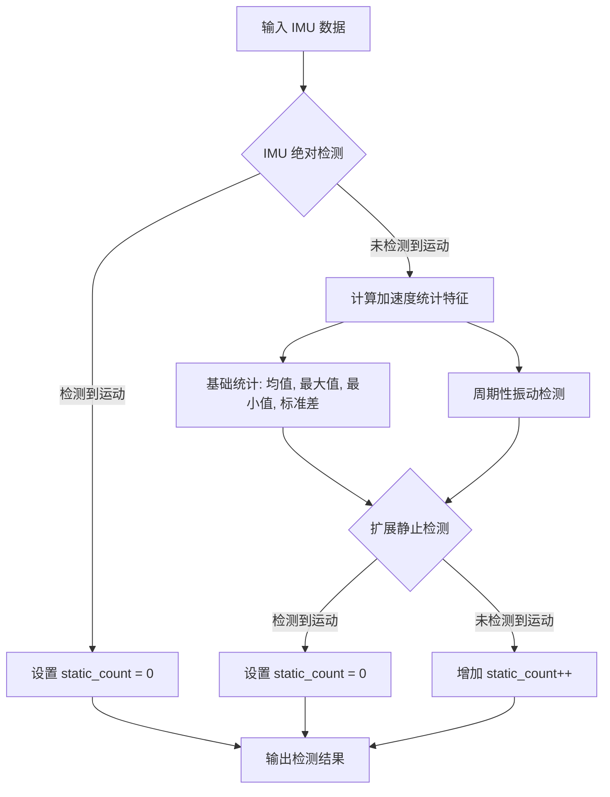

# IMU 运动统计与零速检测

## 1. 数学原理

零速检测算法主要基于两部分：绝对阈值检测（瞬态检测）和加速度信号的统计特征分析。

### 1.1 绝对阈值检测

该步骤对陀螺仪和加速度计分别使用自适应阈值，以检测是否存在显著的瞬态运动。

**陀螺仪检测:**
自适应阈值定义为：
$$
\mathbf{th} = \mathbf{gyro\_rms} + \alpha \cdot \mathbf{gyro\_bias\_tipical} + 3 \cdot \mathbf{gyro\_rms\_tipical}
$$

其中，$\alpha$ 是零偏补偿系数。若零偏有效，$\alpha = 0.2$（即至少补偿了80%的零偏）；否则，$\alpha = 1.0$。

- **单轴最大值检测：** 如果任意轴上的测量值绝对值 ($|meas_i|$) 超过 $\mathbf{t h}$，则判定为运动状态；
- **RMS 均值检测：** 捕获所有轴上微小但连续的运动，若 $\sqrt{\frac{\omega_x^2 + \omega_y^2 + \omega_z^2}{3}} > \mathbf{t h}$，则判定为运动状态。

**加速度计检测:**
自适应阈值定义为：
$$
\mathbf{th} = \mathbf{acc\_rms} + \beta \cdot \mathbf{acc\_bias\_fac} + 3 \cdot \mathbf{acc\_rms\_tipical} + k \cdot \mathbf{G}_0
$$

其中，$\beta$ 是零偏补偿系数。若零偏有效， $\beta = 0.4$，否则为 $1.0$；$k \cdot \mathbf{G}_0$  为不确定性裕度。

- **重力模长检测：** 比较测量值的模长与重力加速度 $G_0$。如果 $| \|acc\| - \mathbf{G}_0 | > \sqrt{3} \cdot \mathbf{th}$，则判定为运动状态。

### 1.2 加速度测量特征提取

若通过了绝对检测，算法将分析加速度数据的缓冲区，以提取统计特征：

- **基础统计：** 计算每个轴的均值 (Mean)、最大值 (Max)、最小值 (Min) 和标准差 (Std)。

- **周期性振动检测（延迟平均法）：**
	当载体处于周期性振动环境（如发动机怠速）时，方差会增大，这可能导致误判为“运动”。算法搜索一个半周期延迟 $k$，使得对延迟信号求平均后方差显著降低。

## 2. 检测流程图

代码参考：https://github.com/ZoYooJy/Vehicle-Motion-State-Detect.git